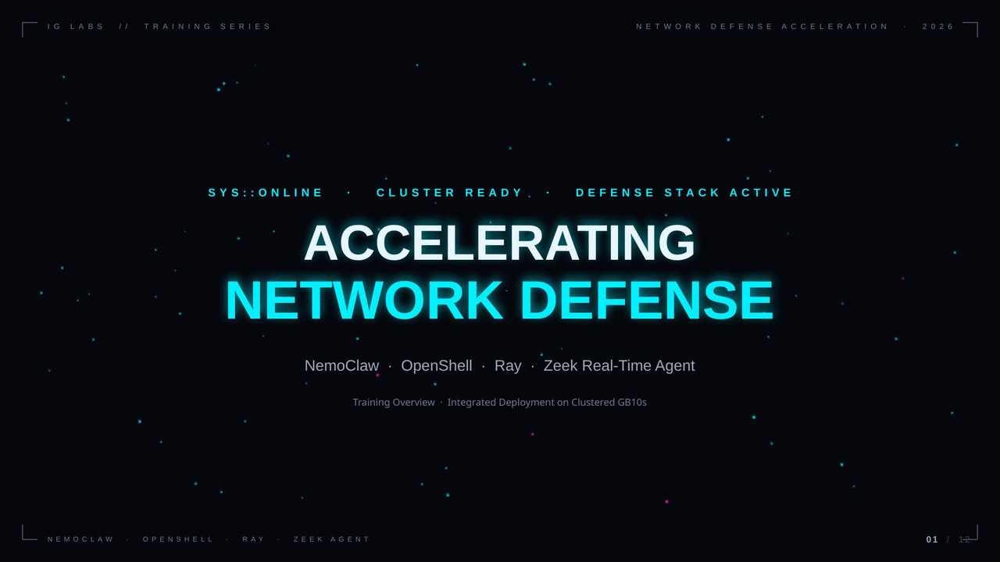

# Zeek Agent 



*Training overview of [NemoClaw](https://docs.nvidia.com/nemoclaw/latest/), [OpenShell](https://docs.nvidia.com/openshell/), [Ray](https://docs.ray.io/), and the Zeek agent (autoplays in GitHub)*

Consolidated deployment: multi-node vLLM (Ray) + NemoClaw/OpenShell + Zeek summarizer UI.

## Files

| File | Purpose |
|------|---------|
| `docker-compose.vllm.yml` | Ray head + worker containers (profiles) |
| `Dockerfile.vllm-ray` | Thin image that adds Ray to `vllm/vllm-openai` |
| `start-vllm.sh` | Starts vLLM **inside** the ray-head container |
| `deploy.sh` | One-shot: Ray cluster → vLLM → NemoClaw → analysis |
| `docker-compose.analysis.yml` | Zeek + Streamlit summarizer |
| `.env.example` | Template for cluster IPs, model, ports |

## Why vLLM runs inside ray-head

Running vLLM as a separate container fails to join the Ray session (`No node info found matching attributes`). The working pattern is:

1. Start `ray-head` on the head node and `ray-worker` on the worker node.
2. Confirm `docker exec ray-head ray status` shows **2 nodes / 2 GPUs**.
3. Start vLLM with `docker exec` into `ray-head` (see `start-vllm.sh`).

## Quick start

**Head node**
```bash
cp .env.example .env
# set HEAD_IP, WORKER_IP, NCCL_IF (ConnectX interface), HF_TOKEN, ZEEK_IFACE

chmod +x deploy.sh start-vllm.sh
./deploy.sh
```

**Worker node** (in another terminal or after head is up)
```bash
cp .env.example .env
# set HEAD_IP to the head's ConnectX IP, WORKER_IP to this node's ConnectX IP, NCCL_IF

./deploy.sh --worker-only
```

## Manual steps

**Head**
```bash
docker compose -f docker-compose.vllm.yml --profile head up -d --build
# wait until ray status is healthy
docker exec ray-head ray status

# only after 2 GPUs are visible:
./start-vllm.sh
docker logs -f ray-head
```

**Worker**
```bash
docker compose -f docker-compose.vllm.yml --profile worker up -d --build
```

## Important

- Run **only** the `head` profile on the head and **only** the `worker` profile on the worker. Running both on one node registers duplicate nodes.
- `NCCL_IF` must be the ConnectX / high-speed interface (e.g. `enp1s0f1np1`), not the management NIC.
- `HEAD_IP` and `WORKER_IP` must be the IPs on that ConnectX interface.
- First model load can take several minutes.

## URLs

- Summarizer UI: http://localhost:8501
- vLLM OpenAI API: http://localhost:8000/v1
- Ray dashboard: http://<HEAD_IP>:8265
- OpenShell gateway: port 9090 (default)

## Stop

```bash
docker compose -f docker-compose.analysis.yml down
docker compose -f docker-compose.vllm.yml down
nemoclaw stop --all || true
openshell gateway stop || true
```

## Notes

- Zeek runs with host networking so it can see the real capture interface (`ZEEK_IFACE`).
- The summarizer reaches vLLM via `host.docker.internal`.
- NemoClaw is onboarded non-interactively to the already-running vLLM endpoint.

## How NemoClaw and OpenShell Protect the Ray Cluster Running vLLM

In this setup, **NemoClaw + OpenShell form the security and lifecycle boundary** between the Zeek agent and the Ray + vLLM cluster. They do not sit *inside* the Ray cluster; they wrap and mediate access *to* it.

### Roles in the stack

| Component | Role | What it protects |
|-----------|------|------------------|
| **Ray + vLLM** | Compute layer | Serves the large Nemotron model across the two GB10s (tensor parallel). Runs as containers; no agent logic lives here. |
| **OpenShell** | Secure runtime / gateway | Sandboxes the agent, enforces policy on what the agent can touch (files, network, credentials). |
| **NemoClaw** | Onboarding + lifecycle control plane | Configures the sandbox, points the agent at the local vLLM endpoint, and manages the OpenShell environment. |

### How protection actually works here

1. **Agent isolation (OpenShell)**  
   The Zeek summarizer runs inside an OpenShell sandbox. It does **not** have free access to the host, the Ray processes, or the GPU nodes. OpenShell applies kernel-level controls (file access, system calls, network) and only allows the agent the permissions it needs.

2. **Controlled inference access**  
   NemoClaw onboards the inference provider and points it at your local vLLM endpoint (`http://...:8000/v1`). OpenShell brokers that connection. The agent can call the OpenAI-compatible API, but it cannot reach arbitrary ports, other containers, or the Ray dashboard. Credentials (if any) stay outside the agent sandbox.

3. **Lifecycle and capability checks (NemoClaw)**  
   During onboarding, NemoClaw validates the gateway, port alignment, and inference endpoint before the agent is allowed to run. This prevents the agent from starting with overly broad access or a misconfigured path to the cluster.

4. **Separation of concerns**  
   - Ray/vLLM = pure model serving (no agent code).  
   - OpenShell = runtime boundary.  
   - NemoClaw = policy + onboarding layer that ties them together.  

   A misbehaving or compromised summarizer is contained by the sandbox and cannot directly attack the Ray head, worker, or GPUs.

### What this does *not* do (in the current deployment)

- It does not add authentication or network policies *inside* the Ray cluster itself.
- It does not protect the vLLM containers from other processes on the host.
- The protection is primarily **agent → compute** direction, not the other way around.

In short: the Ray + vLLM cluster is the high-value compute target. NemoClaw and OpenShell keep the Zeek agent in a controlled sandbox so it can *use* the model endpoint without being able to reach into the cluster or the nodes.
